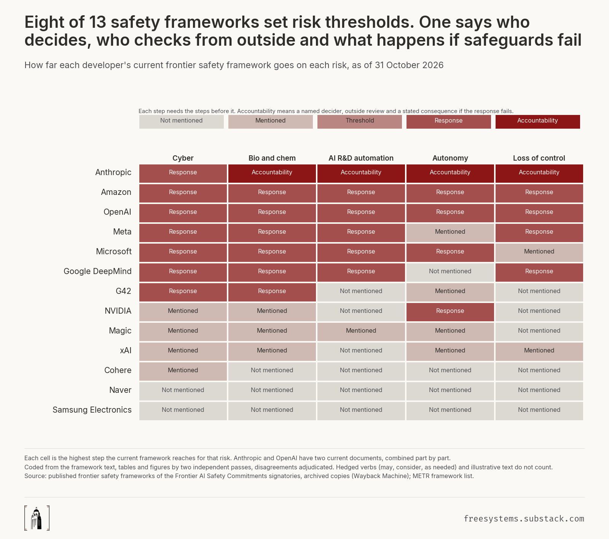

# rung

What frontier AI safety frameworks commit to, risk by risk.

For every published frontier safety framework of the 20 Frontier AI Safety Commitments signatories, this repository codes five risks (cyber, bio and chem, AI R&D automation, autonomy, loss of control) on one ladder: not mentioned, mentioned, threshold defined, response specified, accountability named. Accountability means a named decider, a commitment to outside review, and a stated consequence if the response fails. Every published version up to 31 October 2026 is coded the same way, so changes between versions show up as data.

Result, as of 31 October 2026: of 13 developers with a framework, 8 set a threshold for at least one risk and all 8 commit to a response; 4 (Amazon, Anthropic, G42, OpenAI) reach full accountability on any risk. Outside review is the step most often missing. Across 40 versions, a risk's step went up 14 times and down 12 times. The full write-up is [docs/methods.md](docs/methods.md).



## Folders

| Folder | What is in it |
|---|---|
| `frameworks/` | the census of all 20 signatories (`universe.yaml`, `search_log.csv`), the 40 coded versions with sha256 and sources (`documents.csv`), the Wayback history of every framework URL |
| `coding/` | codebook, coder and adjudicator briefs, both coders' files (`passes/A`, `passes/B`), adjudication and cross-version rulings, final `codes.csv` and the quote behind every 1 in `quotes.csv` |
| `analysis/` | the ladder rules, tables, charts and the claim checker; outputs in `analysis/out/` |
| `docs/` | spec, task list, journal (evidence log, freeze entry) and the methods note |
| `tests/` | the acceptance tests in the spec |

## Reproduce

```
python3 -m pytest -q                  # all acceptance tests
python3 -m coding.check A B --agreement
python3 -m coding.merge               # final codes from both passes and the rulings
python3 -m analysis.verify_claims     # every number in docs/methods.md against the data
```

Document bytes are cached outside the repository in `~/.rung-cache/`; `python3 -m frameworks.build_documents` rebuilds the cache from the sources listed in `frameworks/universe.yaml` and checks every hash. Charts are drawn with a chart kit that is not included in this repository, so `python3 -m analysis.plot` needs it in `analysis/fs_kit`.

## Coding

Two independent coders (both Claude models) coded all 1,200 cells, backing every yes with a verbatim quote that a script checks against the document. A fresh adjudicator ruled on the 95 disagreements, and every change between versions was re-checked with both versions side by side. Agreement and limits are in the methods note.
